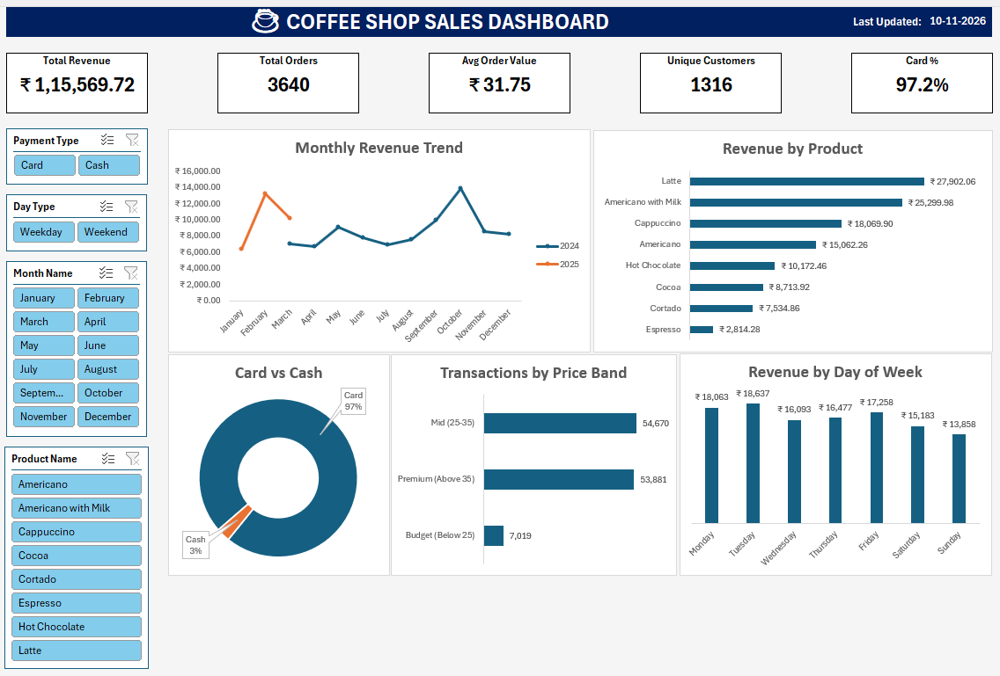

# ☕ Coffee Shop MIS Dashboard

## 📌 Project Overview
This project is an end-to-end MIS reporting solution for a coffee shop's sales data (March 2024 - March 2025). The goal was to clean raw transactional data, build a dynamic dashboard, and extract actionable business insights.

## 🛠️ Tools & Skills Used
*   **Data Cleaning:** Power Query (Type conversion, handling nulls, calculating custom columns)
*   **Data Modeling:** Excel Tables & Structured References (`tblSales`)
*   **Advanced Formulas:** SUMIFS, COUNTIFS, XLOOKUP, INDEX-MATCH, UNIQUE, FILTER, SORTBY
*   **Dashboarding:** Pivot Tables, Pivot Charts, Slicers (Report Connections)
*   **UI/UX Design:** Custom KPI Cards, Interactive Filtering, Color-coded visuals

## 📊 Dashboard Preview

## 💡 Key Business Insights Discovered
1.  **Digital First:** 97.2% of customers prefer paying by Card, while only 3% use Cash.
2.  **Top Products:** Latte and Americano with Milk drive ~46% of total revenue.
3.  **Traffic Trends:** Tuesdays are the busiest days, indicating a commercial/B2B customer base rather than weekend retail traffic.
4.  **Pricing Sweet Spot:** The Mid (25-35) and Premium (>35) price bands account for 94% of transactions.

## 📈 Recommendations
*   Launch a digital loyalty program targeting card users.
*   Introduce a "Weekend Brunch Combo" to boost low weekend footfall.
*   Optimize the menu by bundling lower-selling items (like Espresso) with top sellers.

## 🧠 Challenges Overcome
*   **Data Corruption:** The raw CSV was corrupted upon opening in Excel. I rebuilt the dataset using **Power Query** with strict locale data types to ensure 100% data integrity.
*   **Dynamic KPIs:** Regular formulas don't respond to slicers. I built a dedicated `KPI_Pivot` table to ensure KPI cards update dynamically with user selections.
